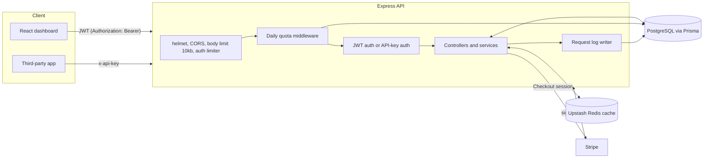
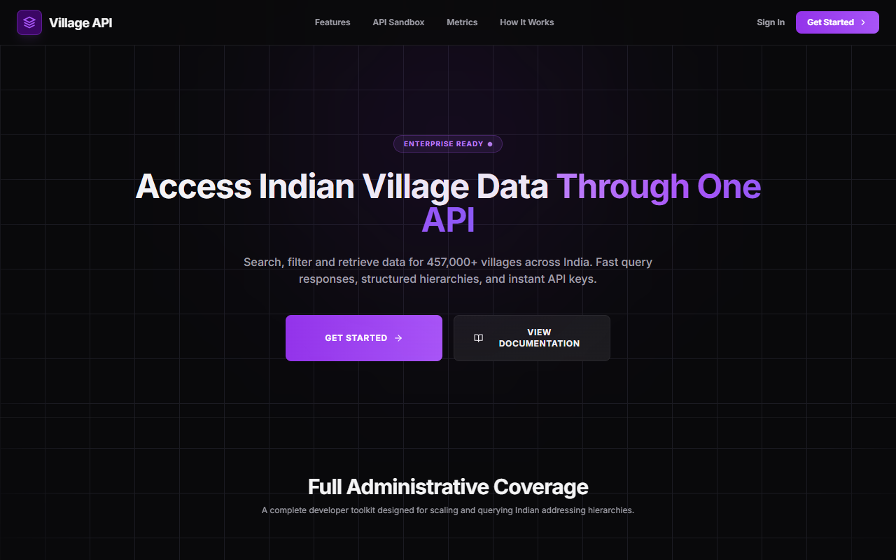
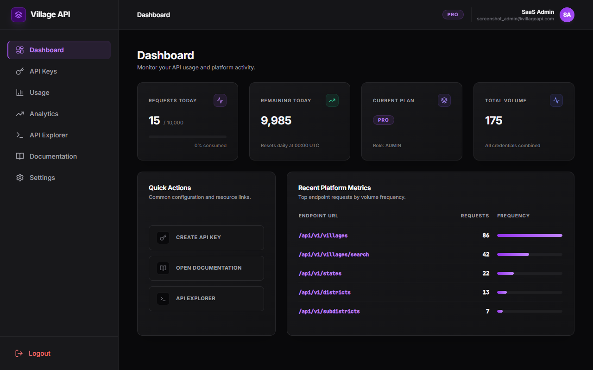
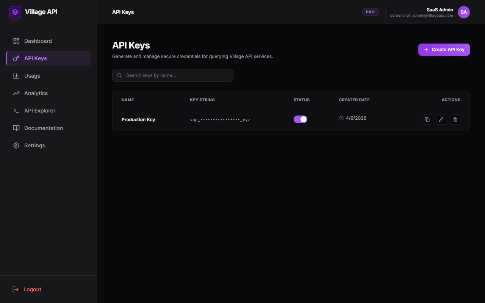
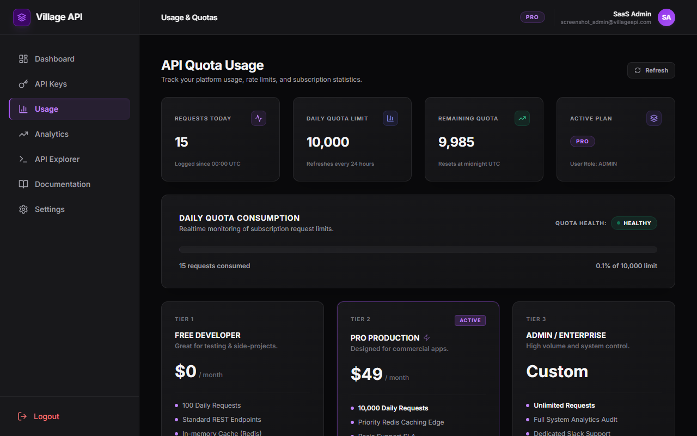
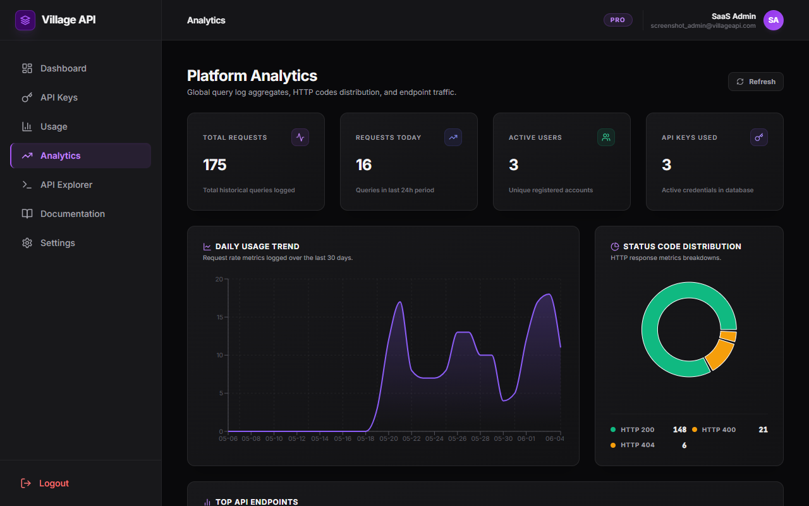
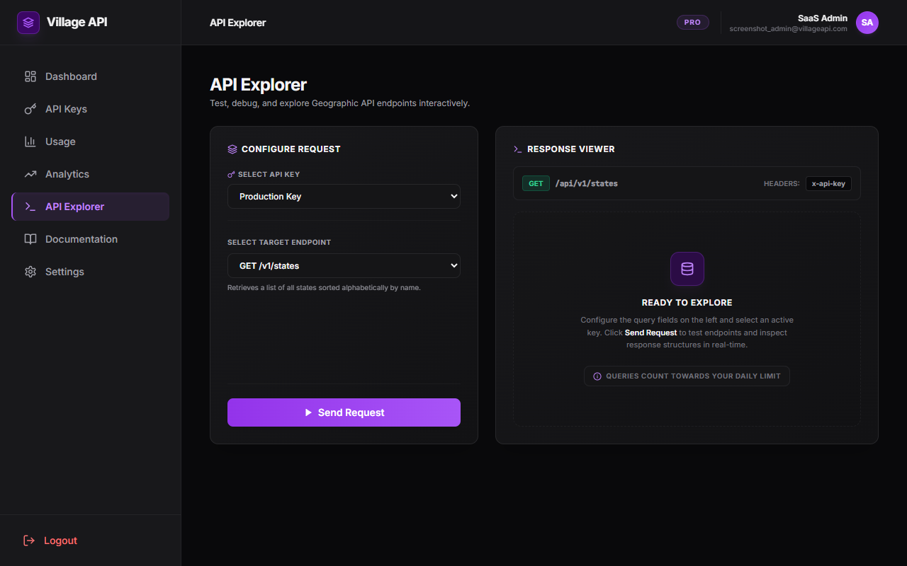

# CensusGrid

CensusGrid (repository: `village-api`) is a REST API for looking up Indian administrative geography: **State -> District -> Sub-district -> Village**. Developers sign up in a React dashboard, create API keys, call the data endpoints with an `x-api-key` header, and see their usage. A Pro plan (Stripe subscription) raises the daily quota and unlocks analytics.

It is a full-stack portfolio project: an Express/Prisma/PostgreSQL backend with API-key auth, per-plan rate limiting, request logging, Redis caching and Stripe billing, plus a Vite/React dashboard.

## The problem

Rural addresses in India are hard to normalise: village names are spelled many ways and the same name repeats across districts. The Census of India publishes a structured village directory, but it ships as one Excel file per state. CensusGrid loads that directory into PostgreSQL and exposes it as a small, cacheable lookup API with the account, quota and billing plumbing a public API needs.

## What is implemented

| Area | Details |
| --- | --- |
| Data | Importer for the Census 2011 village directory (29 `.xls` files bundled as a zip) into Country/State/District/SubDistrict/Village tables (Prisma, bulk `createMany`) |
| Data API | `GET /api/v1/states`, `/districts`, `/subdistricts`, `/villages`, `/villages/search`, `/villages/:villageCode`, authenticated by API key |
| Accounts | Register / login (bcrypt, JWT HS256, 7-day expiry), profile and password update |
| API keys | Create, list, enable/disable and delete keys per user (`vap_` + 48 hex chars) |
| Rate limiting | Daily quota per user, counted from the request log table: FREE 100/day (configurable), PRO 10,000/day, ADMIN/ENTERPRISE unlimited. Separate per-IP limiter on login/register |
| Caching | Redis (Upstash) cache for lookup responses, 1 hour TTL; falls back to a per-process in-memory map when Redis is not configured, and cache errors never fail a request |
| Analytics | Request counts, per-endpoint counts, status codes and 30-day trend from the request log. PRO users see their own data; ADMIN sees everything |
| Billing | Stripe Checkout subscription ($49/month in code) and a signature-verified webhook that sets the plan to PRO or back to FREE |
| Docs | OpenAPI/Swagger UI at `/api-docs`, Postman collection in `backend/` |
| Dashboard | React 18 + Vite + Tailwind + Recharts: keys, usage, analytics, API explorer, settings, a read-only demo login |

## Architecture



Request flow for a data call: the quota middleware resolves the API key and counts today's rows in `ApiLog`; the route middleware authenticates the key; the controller checks the cache, falls back to PostgreSQL, caches the result; a `finish` hook writes one `ApiLog` row (this row is what quota, usage and analytics are computed from).

Route groups:

| Prefix | Auth | Purpose |
| --- | --- | --- |
| `/api/auth/*` | none (IP rate-limited) | register, login, demo login |
| `/api/v1/*` | `x-api-key` | geographic data |
| `/api/keys`, `/api/users`, `/api/billing/checkout`, `/api/usage/me` | JWT (`/usage/me` also accepts `x-api-key`) | account self-service |
| `/api/analytics/*` | JWT + PRO or ADMIN | request analytics |
| `/api/system/info` | JWT + ADMIN | runtime info |
| `/api/billing/webhook` | Stripe signature | plan changes |
| `/health`, `/api-docs` | none | health check, Swagger UI |

## API examples

All data endpoints need `x-api-key: vap_...` (create a key in the dashboard or via `POST /api/keys`). Responses use `{ "success": true, ... }`; errors use `{ "success": false, "message": "..." }`. Field shapes below are exact; the values are illustrative.

```bash
BASE=http://localhost:3000
KEY=vap_your_api_key_here

# States
curl -H "x-api-key: $KEY" "$BASE/api/v1/states"
# { "success": true, "count": n, "data": [ { "id": 1, "name": "...", "stateCode": "10" } ] }

# Districts of a state (stateCode is required)
curl -H "x-api-key: $KEY" "$BASE/api/v1/districts?stateCode=10"
# { "success": true, "count": n, "data": [ { "id": 1, "name": "...", "districtCode": "..." } ] }

# Sub-districts of a district (districtCode is required)
curl -H "x-api-key: $KEY" "$BASE/api/v1/subdistricts?districtCode=<districtCode>"
# { "success": true, "count": n, "data": [ { "id": 1, "subDistrictCode": "...", "name": "..." } ] }

# Paginated villages; filters stateCode, districtCode, subDistrictCode; limit max 100 (default 50)
curl -H "x-api-key: $KEY" "$BASE/api/v1/villages?stateCode=10&page=1&limit=20"
# { "success": true, "page": 1, "limit": 20, "count": <total matches>, "data": [ { "villageCode": "...", "name": "..." } ] }

# Search by name: q required, 1-100 chars, case-insensitive substring, max 20 results
curl -H "x-api-key: $KEY" "$BASE/api/v1/villages/search?q=rampur"
# { "success": true, "count": n, "data": [ { "villageCode": "...", "name": "..." } ] }

# One village with its hierarchy
curl -H "x-api-key: $KEY" "$BASE/api/v1/villages/<villageCode>"
# { "success": true, "data": { "villageCode": "...", "villageName": "...", "state": "...", "district": "...", "subDistrict": "...", "fullAddress": "..." } }
```

Account endpoints:

```bash
curl -X POST $BASE/api/auth/register -H 'Content-Type: application/json' \
  -d '{"name":"Ada","email":"ada@example.com","password":"at-least-8-chars"}'
curl -X POST $BASE/api/auth/login -H 'Content-Type: application/json' \
  -d '{"email":"ada@example.com","password":"at-least-8-chars"}'      # -> data.token
curl -X POST $BASE/api/keys -H "Authorization: Bearer $TOKEN" -H 'Content-Type: application/json' \
  -d '{"name":"my first key"}'                                           # -> data.key
curl -H "x-api-key: $KEY" $BASE/api/usage/me                             # requestsToday, dailyLimit, remaining
```

Status codes: `400` validation, `401` missing/invalid credentials, `403` inactive key/account or insufficient plan/role, `404` not found, `429` daily quota exceeded (or too many auth attempts), `503` billing/webhook not configured.

## Local setup

Requirements: Node 20+, a PostgreSQL database (a local container or a free Neon database both work).

```bash
git clone https://github.com/likhith1253/village-api.git
cd village-api/backend
cp .env.example .env          # fill in DATABASE_URL and JWT_SECRET (see comments in the file)
npm install                   # also runs `prisma generate`
npx prisma migrate deploy     # create tables
npm run dev                   # http://localhost:3000  (Swagger UI at /api-docs)

# dashboard, in another terminal
cd ../frontend
cp .env.example .env
npm install
npm run dev                   # http://localhost:5173
```

Only `DATABASE_URL` and `JWT_SECRET` (random, 32+ characters) are required; the server refuses to start without them. Stripe and Upstash are optional (billing returns 503; caching uses the in-memory fallback).

If you already have a database that was created with `prisma db push`, mark the catch-up migration as applied instead of running it: `npx prisma migrate resolve --applied 20260701000000_sync_schema_drift`.

### Loading the data

The repository bundles `backend/data/all-india-villages-master-list-excel.zip` (about 19 MB, 29 state/UT files named `Rdir_2011_<code>_<STATE>.xls`).

```bash
cd backend
npm run data:extract          # extracts to backend/data/dataset (git-ignored)
npm run import:sample         # optional: first 100 villages of Bihar to try things out
npm run import:all            # full import (two passes: in-memory parse, then bulk inserts)
npm run verify:import         # row counts and sanity checks
```

Set `DATASET_DIR` (or pass a directory as the first argument) to read the `.xls` files from elsewhere. The importers write to whatever `DATABASE_URL` points at, so check it before running them.

### Data source and licence

The files are the Census of India 2011 village directory (MDDS-coded: state, district, sub-district and village codes). The archive's original download location is not recorded in this repository, and its redistribution terms have not been verified. Government of India open data is commonly published under the Government Open Data License - India (GODL), but confirm the original publisher's terms before reusing the data commercially. Census 2011 boundaries and names are over a decade old, so newer districts and renamed villages are missing.

## Tests and tooling

```bash
cd backend
npm test        # node:test, no database or network needed (Prisma is faked in-process)
npm run lint    # eslint
cd ../frontend && npm run build
```

The test suite boots the real Express app and checks: every protected route returns 401 without credentials; JWT algorithm/expiry handling; role and plan gates; API-key ownership (IDOR) checks; analytics scoping; Stripe webhook signature handling; error responses not leaking internals; input validation and pagination caps; CORS; rate limits. GitHub Actions (`.github/workflows/ci.yml`) runs install, lint, tests, a production-dependency audit and the frontend build.

## Security notes

- Passwords: bcrypt (cost 10), 8-72 characters. JWTs: HS256 only, verified against a secret that must be 32+ characters.
- Rate limiting and analytics are computed from the database, not from JWT claims, so plan changes apply immediately.
- The Stripe webhook is closed unless `STRIPE_WEBHOOK_SECRET` is set and every event must carry a valid signature.
- 5xx responses return a generic message; details are logged server-side only.
- The demo login issues a short-lived token that never touches the database; it cannot modify profile or password.

## Limitations

- **API keys are stored in plaintext** in the database and returned by `GET /api/keys` (so the dashboard can show them). Hashing them (show once at creation) is the main planned security improvement; it needs a data migration and a dashboard change.
- Plan descriptions in the UI mention key-count limits (3 keys on Free) that the backend does not enforce. There is no Enterprise purchase flow; the plan only exists as a manual database value.
- The daily quota counts `ApiLog` rows with a database query per request and uses the server's local midnight; this is simple but not designed for very high traffic. Log rows are written after the response, so a burst can slightly exceed the limit.
- The in-memory cache fallback and the login limiter are per process; they do not coordinate across multiple instances.
- Search is a case-insensitive substring match, with no fuzzy or phonetic matching.
- Data is Census 2011 only.
- No load testing or uptime measurements have been done, so there are no performance numbers here.
- Frontend dev dependencies (Vite/esbuild) and `react-router` 6 have open advisories whose fixes need major upgrades; `xlsx` (import scripts only, a dev dependency) has no upstream fix.

## Deployment

The repo references a Vercel frontend (`censusgrid.vercel.app`) and a Render backend. Those hosted instances were not checked as part of this work. See `backend/.env.example` and `frontend/.env.example` for the variables a deployment needs.

## Screenshots

| | |
| --- | --- |
|  |  |
|  |  |
|  |  |

## License

MIT, see [LICENSE](LICENSE). Contributions: see [CONTRIBUTING.md](CONTRIBUTING.md).
